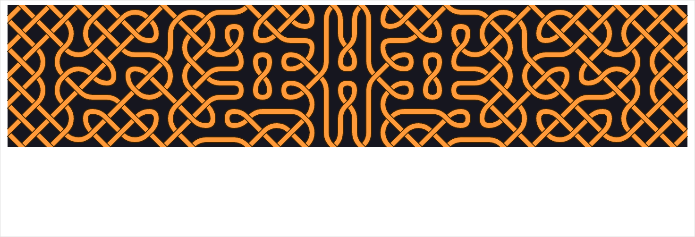
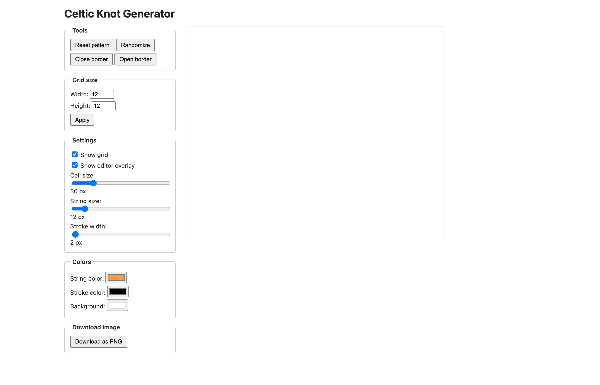

# Celtic Knot Generator — TypeScript



A Celtic knotwork generator and pattern editor, written in TypeScript with
zero runtime dependencies.

Inspired by Janis Elsts' original Celtic Knot Generator
(w-shadow.com/celtic-knots). Independently reimplemented.

## Try it

**Live: [celtic-knots.cole.press](https://celtic-knots.cole.press)**

Or open `celtic-knots.html` locally — a fully self-contained build. No
server, no install, no build step: double-click it (or drag it into any
browser) and it just runs, offline, in Chrome, Safari, Orion — anything.

> Don't open the top-level `index.html` — that's the dev entry point and
> only works through the dev server.




## How it works

The pattern is a grid of **cuts** — breaks between strands. Each knot cell is
rendered from the two nearest cuts plus the cell's row/column parity, looked
up in a 36-entry tile matrix (`src/knot/tiles.ts`). Tiles are built from a
handful of base drawing functions combined with rotation and mirroring, so
the whole visual language is a few dozen lines of canvas geometry.

Editing works by clicking **control nodes** on the staggered lattice and
drawing cuts between them; `Randomize` produces symmetric patterns by
mirroring each cut left-right or across all four quadrants.

## Layout

```
src/knot/
  types.ts     — settings, cut states, shared types
  tiles.ts     — base tile drawings + the 36-state tile matrix
  pattern.ts   — cut grid, symmetric randomizer, border states (pure, tested)
  render.ts    — knotwork renderer + editor overlay (pure canvas functions)
  editor.ts    — KnotEditor class: canvas, mouse interaction, PNG export
  main.ts      — UI wiring
```

## Commands

```bash
pnpm install
pnpm dev        # dev server
pnpm test       # vitest — 20 tests over pattern + tile invariants
pnpm build      # typecheck + production build (also emits celtic-knots.html)
pnpm preview    # serve the built app
```

## Features

- Adjustable grid size, cell size, string size, stroke width
- String / stroke / background colors
- Click-to-draw cuts on the control-node lattice (with hover preview)
- Randomize (symmetric), reset, open/close border
- Show/hide grid and editor overlay
- PNG export of the knot alone (no editor overlay) via native `canvas.toBlob`

## License

MIT — see [LICENSE](LICENSE).
